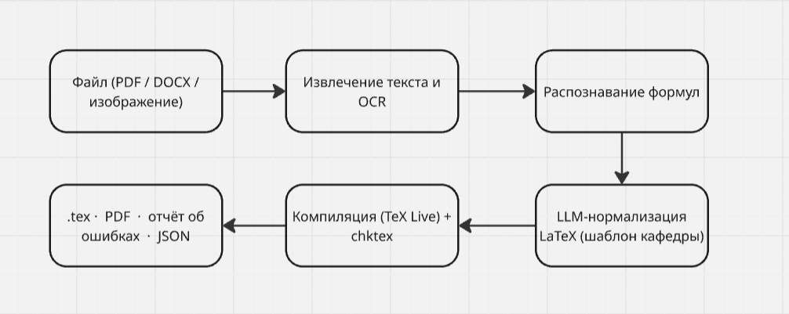

# ScanFormulMIREA
 
Программа принимает PDF, Word или изображение, извлекает текст и формулы, переводит их в LaTeX по шаблону кафедры и проверяет результат на ошибки.
 
## Зачем это нужно
 
Ручной перенос формул в LaTeX отнимает много времени и часто приводит к ошибкам:
 
- 10 страниц с формулами вручную переносятся за 3-6 часов, проверка занимает ещё 1-2 часа;
- при копировании из PDF формулы ломаются;
- без автоматизации сложно собрать большой набор задач.
Проект закрывает эту проблему и отличается от аналогов (Mathpix, LaTeX-OCR, Pandoc) тремя вещами:
 
1. оформление под **шаблон кафедры**;
2. **проверка ошибок** (компиляция и линтер);
3. **связь с проектом №5** через экспорт в JSON.
## Для кого
 
- преподаватели и методисты;
- студенты;
- участники проекта №5.
## Возможности
 
| Функция | Описание |
|---|---|
| Приём файлов | PDF, Word (.docx), изображения |
| Извлечение текста | Текст из документов, OCR для сканов и картинок |
| Распознавание формул | Перевод формул в LaTeX |
| Нормализация | Приведение LaTeX к единому виду и шаблону кафедры с помощью LLM |
| Валидация | Компиляция в TeX Live и проверка через `chktex` |
| Экспорт | `.tex`, PDF, отчёт об ошибках, JSON для проекта №5 |
 
## Как это работает


 
Обязательная компиляция LaTeX нужна в том числе как защита от ошибок LLM в формулах.
 
## Технологии
 
| Компонент | Назначение |
|---|---|
| Python | Обработка текста и ML |
| FastAPI | API и связка с Python-библиотеками |
| Streamlit | Интерфейс для MVP |
| Mathpix API | Распознавание формул на старте |
| Tesseract / PaddleOCR | Распознавание текста на изображениях |
| LLM | Нормализация LaTeX |
| TeX Live, chktex | Компиляция и проверка LaTeX |
| SQLite / PostgreSQL | Хранение результатов |
| Docker | Единый запуск |
 
## Критерии успеха MVP
 
- распознавание формул: более 85%;
- обработка 10 страниц: менее 5 минут;
- 80% простых документов компилируются без правок;
- находится более 90% основных ошибок LaTeX;
- на выходе есть `.tex` и JSON для проекта №5.
## Быстрый старт
 
> Раздел будет уточнён после появления рабочей версии. Ниже ориентировочная схема запуска через Docker.
 
```bash
# клонировать репозиторий
git clone <URL_РЕПОЗИТОРИЯ>
cd <ПАПКА_ПРОЕКТА>
 
# задать ключи (например, для Mathpix и LLM)
cp .env.example .env
 
# собрать и запустить
docker compose up --build
```
 
После запуска интерфейс будет доступен в браузере (адрес и порт будут указаны в документации).
 
## Структура проекта
 
> Предполагаемая структура, будет уточняться.

## Дорожная карта
 
| Спринт | Недели | Содержание |
|---|---|---|
| 1 | 1-2 | Паспорт, роли, анализ аналогов, выбор шаблона LaTeX |
| 2 | 3-4 | Сбор 10-15 тестовых файлов, прототип извлечения текста |
| 3 | 5-6 | OCR, распознавание формул |
| 4 | 7-8 | LLM-нормализация, компиляция, chktex |
| 5 | 9-10 | Валидатор ошибок, веб-интерфейс, подключение БД |
| 6 | 11-12 | Экспорт .tex/PDF/JSON, связка с проектом №5, Docker |
| 7 | 13-14 | Тесты на 20-30 документах, исправление ошибок |
| 8 | 15-16 | Документация, инструкция, подготовка к защите |
 
**Ключевые вехи:** неделя 3 - готов датасет; неделя 6 - работает распознавание формул; неделя 10 - интеграция с интерфейсом; неделя 12 - MVP; неделя 14 - стабильность на 20-30 документах; неделя 16 - защита.
 
## Риски
 
| Риск | Как снижаем |
|---|---|
| Плохие сканы и PDF | Предобработка изображений, несколько OCR |
| Сложные формулы | Начинаем с простых, усложняем постепенно |
| Ошибки LLM в формулах | Обязательная проверка компиляцией |
| Лимиты и стоимость API | Кэширование, переход на локальные модели |
| Мало тестовых данных | 20-30 документов и синтетические примеры |
| Нехватка времени | Упрощение объёма работ, приоритет MVP |
 
## Команда
 
Группа **ЭФБО-09-25**, РТУ МИРЭА.
 
| Участник | Зона ответственности |
|---|---|
| Аль Нувейни Разен | Серверная часть и API, работа с файлами, распознавание формул, интеграция с проектом №5 |
| Тагиров Магомедхабиб | LaTeX-шаблон, проверка ошибок, интерфейс, тестирование, документация, база данных и Docker |
 
Роли могут пересекаться, так как в команде два человека.
 
